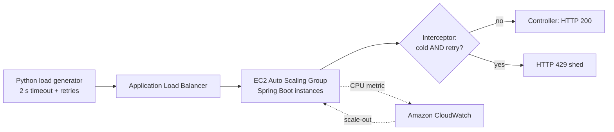

# Retry-Aware Load Shedding for Autoscaling Metastable Failures on AWS

Application-layer mitigation of the **autoscaling trap**: new, cold Spring Boot instances are overwhelmed by client retries, the Auto Scaling Group reads the saturation as demand and launches more cold instances. This project tests a small Spring `HandlerInterceptor` that lets each instance shed retries while it is still cold.

> M.Tech (CSE) Cloud Computing project, National Institute of Technology Warangal.
> Authors: Alok Kumar Sah, Manish Kumar Sah. Guide: Dr. Manoj Kumar Patra.

---

## Table of contents

1. [The problem](#the-problem)
2. [The idea](#the-idea)
3. [Architecture](#architecture)
4. [Repository structure](#repository-structure)
5. [Tech stack](#tech-stack)
6. [Quick start](#quick-start)
7. [Configuration](#configuration)
8. [Running the experiments](#running-the-experiments)
9. [Results](#results)
10. [Limitations](#limitations)
11. [Cost and cleanup](#cost-and-cleanup)
12. [References](#references)

---

## The problem

Elasticity assumes a new server is useful the moment it starts. A JVM service is not: for its first minute or two it is slow while the JIT compiler warms up, caches fill and connection pools open.

1. A load spike raises CPU and the ASG launches new instances.
2. The new instances are cold and slow.
3. Clients with short timeouts give up and retry immediately.
4. The cold instances still finish the abandoned requests, so retries add real CPU work.
5. CPU stays at 100%, and the ASG launches even more cold instances.
6. Cost rises while goodput falls.

Load balancers and autoscalers see only infrastructure signals (CPU, counts, health checks), so they cannot tell a first attempt from a retry. A service mesh can add circuit breaking, but its sidecar proxies use CPU on nodes that are already starved.

## The idea

Make each instance aware of its own readiness. While an instance is **cold**, it answers **HTTP 429** to any request that carries a retry signature (`X-Retry-Count > 0`) and still admits first attempts, so the instance can warm up on real work. Once warm, it admits everything.

```java
if (enabled && state.isCold()) {
    int retry = parse(request.getHeader("X-Retry-Count"));
    if (retry > 0) {
        response.setStatus(429);
        return false;          // controller bypassed
    }
}
return true;
```

The check is a header read and a time comparison, runs before the controller, and needs no sidecar or control plane.

## Architecture



Two launch templates share the same AMI, instance type and settings and differ in **one line** of user data:

| Template | Experiment | `SHEDDING_ENABLED` |
|---|---|---|
| `lt-baseline` | A (baseline) | `false` |
| `lt-protected` | B (protected) | `true` |

## Repository structure

Suggested layout (adjust to match what you upload):

```
.
├── app/                         # Spring Boot service
│   ├── pom.xml
│   └── src/main/
│       ├── java/com/example/shedder/
│       │   ├── ShedderApplication.java
│       │   ├── SimulatedState.java
│       │   ├── RetryShedInterceptor.java
│       │   ├── WebConfig.java
│       │   └── WorkController.java
│       └── resources/application.properties
├── infra/
│   ├── shedder.service          # systemd unit
│   ├── user-data-baseline.sh    # launch template user data (shedding off)
│   └── user-data-protected.sh   # launch template user data (shedding on)
├── loadgen/
│   └── loadgen.py               # Python chaos load generator
├── analysis/
│   └── plots.py                 # comparison plots and summary
├── results/
│   ├── baseline2.csv            # final paired run, Experiment A
│   ├── protected2.csv           # final paired run, Experiment B
│   └── comparison2.png
├── docs/
│   ├── Project_Report.docx
│   └── Presentation.pptx
└── README.md
```

## Tech stack

Java 17 (Amazon Corretto), Spring Boot 3.2.5, Maven 3.9.6, Amazon Linux 2023, AWS EC2 (`t3.micro`), Application Load Balancer, Auto Scaling Group, Amazon CloudWatch, Python 3 (`requests`, `pandas`, `matplotlib`).

## Quick start

### 1. Build the service

```bash
cd app
mvn -q clean package -DskipTests
java -jar target/shedder-0.0.1.jar
```

Test locally:

```bash
curl localhost:8080/health                                   # OK
curl -i -H "X-Retry-Count: 0" localhost:8080/api/work        # 200 (about 1.5 s while cold)
SHEDDING_ENABLED=true java -jar target/shedder-0.0.1.jar &   # then, within the cold window:
curl -i -H "X-Retry-Count: 1" localhost:8080/api/work        # 429
```

### 2. Deploy on AWS (summary)

1. Launch a builder EC2 instance (Amazon Linux 2023), install Java 17 and Maven, build the JAR, and install it as a systemd service (`infra/shedder.service`) that reads `/etc/shedder.env`.
2. Save the instance as an **AMI**.
3. Create the launch templates `lt-baseline` and `lt-protected` from that AMI, using the matching user data (detailed monitoring enabled, no public IP).
4. Create a **target group** (HTTP 8080, health check `/health`, interval 15 s, timeout 10 s, healthy 2, unhealthy 10) and an internet-facing **ALB** (HTTP 80) with security group `sg-alb`. Instances use `sg-app`, which allows port 8080 from `sg-alb` only.
5. Create the **Auto Scaling Group**: min 1, desired 1, max 4, target tracking on average CPU at 50%, instance warm-up 30 s, EC2 health checks, group metrics enabled.

### 3. Run the load generator

```bash
pip install requests pandas matplotlib
python loadgen/loadgen.py --url "http://<ALB-DNS>/api/work" --out baseline2.csv \
  --base-secs 10 --spike-secs 240 --post-secs 120 \
  --base-workers 5 --spike-workers 250 --think 0.2 --max-retries 5
```

### 4. Analyse

```bash
python analysis/plots.py      # reads baseline2.csv and protected2.csv, writes comparison.png
```

## Configuration

Settings are read from environment variables (via `/etc/shedder.env` on the instances).

| Variable | Default | Meaning |
|---|---|---|
| `SHEDDING_ENABLED` | `false` | Turns the interceptor on or off |
| `COLD_SECONDS` | `30` in code, `120` in our experiments | Length of the simulated cold window |
| `WORK_COLD_MS` | `1500` | CPU time per `/api/work` request while cold |
| `WORK_WARM_MS` | `30` | CPU time per request once warm |

`COLD_SECONDS=120` was used because a new instance only receives traffic after the load balancer's health checks pass, which takes about a minute after boot.

Load generator flags: `--url`, `--out`, `--base-workers`, `--spike-workers`, `--base-secs`, `--spike-secs`, `--post-secs`, `--timeout` (default 2.0), `--max-retries`, `--think`.

## Running the experiments

For each experiment:

1. Point the ASG at the right launch template (`lt-baseline` for A, `lt-protected` for B).
2. Scale the ASG to 0 and back to 1 so the first instance is born with that template's setting.
3. Wait until the target group shows the instance **healthy**, then start the load generator.
4. Use identical load-generator flags for A and B.

Important: the cold window runs from instance start, so the delay between launching an instance and starting the load affects every whole-run comparison. See [Limitations](#limitations).

## Results

Final paired run: 5 / 250 / 5 simulated users over 10 s / 240 s / 120 s, 2 s timeout, up to 5 immediate retries.


**Overall (raw) numbers**

| Metric | A: baseline | B: protected |
|---|---|---|
| Goodput during spike (200 per second) | 98.4 | 160.2 |
| Total HTTP 200 | 24,447 | 39,274 |
| Client timeouts | 12,255 | 3,712 |
| Other failures | 12,673 | 4,493 |
| HTTP 429 (shed) | 0 | 2,747 |
| Seconds until goodput first exceeds 100/s | 116 | 56 |

**Like-for-like** (the protected instance was about a minute further through its cold window when the test began, so the raw gap overstates the effect of shedding)

| Per-second rate | A | B |
|---|---|---|
| Cold period: goodput | 1.1 | 3.7 |
| Cold period: timeouts | 105.6 | 65.4 (about 38% fewer) |
| Cold period: 429 shed | 0 | 49.1 |
| Warm window (130 to 250 s): goodput | 189.1 | 206.8 (about 9% more) |
| Warm window: other failures | 105.6 | 35.1 (about 67% fewer) |

Both configurations recovered immediately when the spike ended. This shows a retry-driven overload during the spike, **not** a collapse that sustains itself afterwards.

Earlier runs are in the report: a lighter load showed no failure, and a heavier run with unequal starts showed an apparent benefit the interceptor could not have caused (no sheds).

## Limitations

- Single paired run per intensity; no confidence intervals.
- The cold state is **simulated** (fixed uptime window and a heavier request), not measured JIT or cache readiness.
- The two final runs started at different points of the cold window (about a minute apart, inferred from the timing of the goodput jump).
- CloudWatch CPU and instance counts were not analysed, so scale-out behaviour is not quantified.
- Clients must send `X-Retry-Count`; the load generator drops to 5 users after the spike, which prevents a self-sustaining collapse.
- A shed retry counts as a failed request for the client. No comparison with client backoff, retry budgets or a service mesh.

## Cost and cleanup

The ALB and instances are billed by the hour. Set an AWS budget alert before starting and delete everything when finished: ASG, load balancer, target group, launch templates, AMI and its snapshot, and security groups. The ASG maximum is capped at 4 instances.

## References

1. N. Bronson, A. Aghayev, A. Charapko, T. Zhu, "Metastable failures in distributed systems," HotOS, 2021.
2. L. Huang et al., "Metastable failures in the wild," OSDI, 2022.
3. P. Alvaro, R. Isaacs, R. Majumdar, K.-K. Muniswamy-Reddy, M. Salamati, S. Soudjani, "Formal analysis of metastable failures in software systems," arXiv:2510.03551, 2025.
4. B. Beyer et al. (eds.), *Site Reliability Engineering*, O'Reilly, 2016.
5. M. Brooker, "Timeouts, retries, and backoff with jitter," Amazon Builders' Library.
6. D. Yanacek, "Using load shedding to avoid overload," Amazon Builders' Library.
7. M. Nottingham, R. Fielding, "Additional HTTP Status Codes," RFC 6585, 2012.

## License

Add a license before publishing (for example MIT) and place it in a `LICENSE` file.
